# Architecture and trust boundaries

```mermaid
flowchart LR
  Browser[Local Next.js UI] --> Proxy[Allowlisted same-origin proxy]
  Proxy --> API[Loopback FastAPI]
  API --> Roots[Configured roots + synthetic seed]
  Roots --> Index[Bounded source snapshot]
  Index --> Scan[Ruff + Markdown evidence]
  Scan --> DB[(SQLite records and audit)]
  Scan --> Qwen[Local Ollama / Qwen]
  Qwen --> Gate[Strict edits / scope / AST / risk]
  Gate --> Review[Diff review + explicit approval]
  Review --> Copies[Separate baseline and patched copies]
  Copies --> Validation[Static checks + Git diff check]
  Validation --> Fixture[Fixed tests for verified fixture only]
  Fixture --> Verdict[Regression comparison + export]
```

## Data and lifecycle

Typed Pydantic models represent Repository, Scan, Issue, IssueEvidence, Edit, PatchProposal, RiskReason, Approval, Check and ValidationRun. SQLite stores versioned JSON records by kind and ID and a separate audit table with server UTC timestamps. IDs are random UUIDs; SQL uses parameters. Personal local service; there are no user accounts.

An index reads only allowlisted text. It rejects excessive scans rather than silently sampling. The scanner operates on a new materialized snapshot, so model context and evidence refer to the same bytes even if a source file changes while linting. Ruff uses the binary from the active Python installation, fixed flags, no repository configuration and no cache. Markdown checks make no network requests. Line numbers, tool names, excerpts and rules are preserved.

Only the selected file, evidence, and bounded path inventory are sent to loopback Ollama. The model receives repository contents as untrusted data and must return an extra-fields-forbidden JSON schema. There are no tools or model-generated commands. Model identity, digest and wall time accompany every accepted proposal. Missing model/inference errors stop the flow; no deterministic pretend-AI fallback exists.

The gate requires unique exact old-text matches, one existing evidence file, protected-path exclusion, at most 24 changed lines/16 KB diff, and a valid diff header. Python output must match exact deletion of the reported top-level single-name import (with or without its newline), and pass AST comparison. New comments/encoding declarations and other runtime edits are rejected. This exact-text check closes an encoding-cookie interpretation gap that AST comparison of a Unicode string alone would miss. Markdown scope remains bounded; semantics are human-reviewed and broken paths are checked after approval. Risk is a rule-based category, never a fabricated probability.

Approval rechecks the original fingerprint and gates the stored edit again. It records approval and a `validating` state before creating copies. A process interruption can leave that proposal in `validating`; it cannot be replayed. Rescan/repropose to recover. This P0 deliberately has no automatic durable job retry.

The original is never written. Baseline and patched copies are assembled only from indexed bytes under `data/runs/<id>/`. Git checks the exported diff for applicability against the baseline. Both copies receive static checks; only a byte-for-byte built-in fixture can run the fixed three-test suite. The Python gate prevents new executable structure in that trusted case. Verdict requires the selected issue to disappear, at least one issue resolved, no new issue signatures, a clean diff-applicability check, passing/nonexecuted tests as appropriate, and unchanged source fingerprint. Existing baseline lint/link failures are explicitly retained.

## Execution and privacy boundaries

- Fixed internal executable allowlist (Ruff, Git, current Python), argv arrays, `shell=False`, subprocess timeouts, clean environment without user secrets. No install, test, build or shell command from repository metadata is honored.
- Time limits plus bounded source/output sizes; no kernel CPU/memory quota or OS network sandbox is implemented. Proxy environment settings do not isolate hostile code. Accordingly, arbitrary repository code is never executed.
- Paths reject traversal, absolute/drive paths, backslashes, hidden components, control characters and symlink/junction escapes. Copies cannot preserve executable links. Roots are operator-configured, not browser-provided.
- Protected auth/payment/security/infra/secret/migration labels are withheld. Secret files/directories and heuristic secret-bearing text are excluded from snapshots; heuristic coverage is incomplete.
- Same-origin Next.js mutation guard, backend Origin check, trusted Host list, and loopback binds reduce cross-site requests/DNS rebinding. No remote/multi-user deployment is supported.
- Data is local and unencrypted. Snapshots include selected repository source, so `data/` is excluded from version control. Audit logs include IDs, timings, model identity and validation outcomes, not full source contents.

## UI and implementation choices

The interface exposes live model status, true scanner evidence, filters, protected-path messaging, structured diff, risk reasons, a required approval checkbox, progress/errors, baseline and after output, patch export, local setup and audit history. All controls have semantic labels; responsive CSS and focus states are implemented. All three browser tests passed; five axe scans reported zero violations, with desktop/mobile visual review. These checks are not a WCAG conformance claim.

The side-by-side diff is code-native HTML. Monaco could not be installed from the offline dependency cache and is deferred. Next.js builds with TypeScript's worker API and a single worker because this host refuses the default CLI child-process spawn; type validation remains enabled. Existing compatible dependency artifacts were reused locally, while the lockfile provides normal `npm ci` reproduction. Docker engine was stopped, so container support was not represented as tested.
