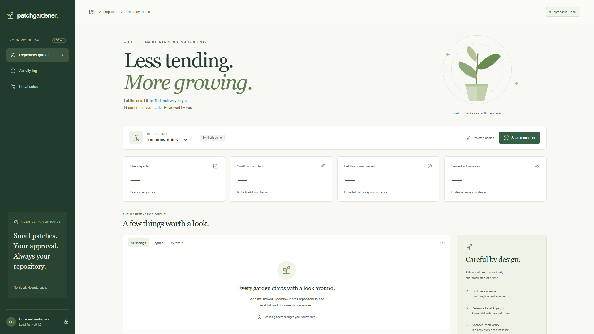
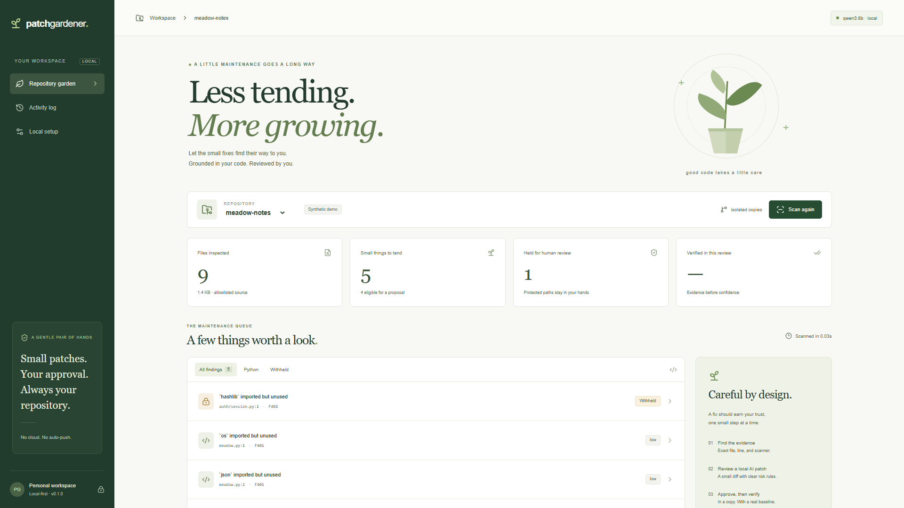
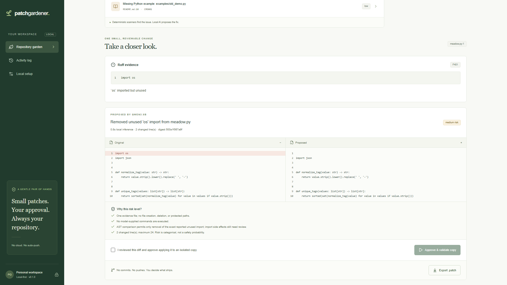
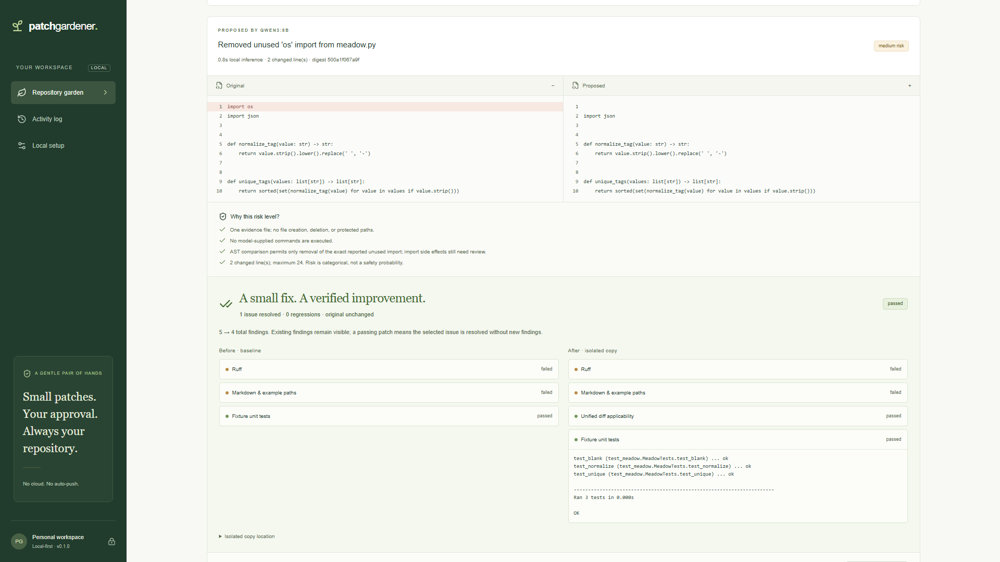

Title: I Built an AI Gardener for the Boring Work Every Open-Source Maintainer Avoids

Tags: devchallenge, hf26challenge, opensource, ai

**Editorial status: PENDING DRAFT, not ready to publish.** The local application, model evaluation, browser verification, seven screenshots and 118.04-second Heart-narrated video are real and complete. GitHub destination/push, YouTube URL and user review remain incomplete. Screenshot links below are local preview paths and must be replaced with verified hosted URLs after the destination is approved. No public links or embeds are invented. The final article must be displayed in full for review.

---

*This is a submission for the [Hacktoberfest Open-Source AI Challenge Week 3: Slow and Steady](https://dev.to/challenges/hacktoberfest-week3-2026-10-19)*

## What I Built

Picture a maintainer opening a repository to make one small change. Before reaching it, they notice an unused import, a README link pointing to a guide that moved, and an example command whose script no longer exists.

None of those tasks is especially difficult. Each still asks for a context switch: locate the evidence, decide what the intended replacement was, edit the file, run checks, and work out whether anything else changed. The burden is in repeating the whole loop for work that rarely feels urgent enough to finish.

PatchGardener turns that loop into a reviewable maintenance queue. It scans a local repository, presents actual tool evidence, asks a local open-weight model for a minimal edit, explains the rule-based risk, and waits for the developer to approve it. Approval creates separate baseline and patched copies. The original stays untouched. The result includes before/after findings, actual test output where execution is permitted, and an ordinary `.patch` file.

The interface is deliberately quiet: a repository selector, a queue, evidence, a diff, a decision, and a result. There is no prompt box asking the maintainer to rediscover what the tool already knows. There is also no automatic push waiting at the end of the journey.

The scope is narrow. P0 handles unused-import findings, inline relative Markdown links, and stale Python example paths. An assistant that can explain precisely what it did is more useful for this task than one that promises to maintain an entire project without supervision.

## Demo

The demonstration repository is Meadow Notes, a fictional note-tagging library included as explicitly synthetic test data. It contains real files and deliberately planted problems. The scanners, local inference, patch creation, approval and validation all run against those files.

One measured example starts here:

```python
import os
import json
```

Ruff identifies the unused `os` import at `meadow.py:1`. Qwen proposes a structured edit against the exact existing text. The validator accepts only removal of the selected import and rejects unrelated executable changes. After approval, the copied version is checked against its baseline, its unit tests run, and the original fingerprint is checked again.

The original scan contains five findings. Fixing this one leaves four. That is shown explicitly rather than painting the entire repository green. The selected issue disappeared, no new issue signatures appeared, the three fixture tests passed, the exported diff was applicable, and the original was unchanged.

Another planted issue lives under `auth/`. It appears in the queue with its real evidence, but the proposal is withheld. Even a small-looking change in a sensitive area should not quietly pass through the same path as a documentation repair.

The actual narrated demo is 118.04 seconds at 1920×1080, using the user's chosen Heart voice with synchronized captions. It shows fresh local inference, explicit approval, a real separate copy, passing fixture tests and patch export. The complete MP4 decoded successfully. A user-uploaded YouTube URL is still pending; there is no invented embed.









## Code

The working source is currently local. The GitHub destination has not been selected or published; that requires the user's explicit choice of username or organization and repository visibility.

The frontend uses Next.js, React, TypeScript and Tailwind, with a shadcn-style button primitive and semantic review controls. FastAPI and typed Pydantic models implement the local API. SQLite keeps scan records, proposals, approvals, validation outcomes and an audit trail. Ollama serves Qwen3-8B on loopback.

Manual setup is documented in the README. Once dependencies and weights are installed, start FastAPI on `127.0.0.1:8105` and Next.js on `127.0.0.1:3105`. The browser talks to a restricted same-origin proxy; source context goes only to the local Ollama instance.

The code separates the indexer, scanner, model proposer, patch gate, fixed-command runner and persistence layer. That separation matters because each answers a different question. Finding an issue does not authorize an edit. Producing valid JSON does not establish safety. Approval does not establish that the result passed validation.

## How I Built It

The first useful boundary was separating static analysis from language-model reasoning.

Ruff knows whether an import is unused. A deterministic link checker knows whether a relative path resolves within the indexed source inventory. Neither needs a model to pretend those are probabilistic judgments. Their output supplies the file, line, tool, rule and exact excerpt shown in the UI.

Qwen is responsible for proposing an edit from that evidence. For a broken guide link, it can choose an appropriate existing destination from the bounded path inventory. For a stale command, it can identify the current example script. It returns structured replacements with a path, exact old substring and replacement text. There are no generated shell commands and no tools delegated to the model.

The default model is Qwen3-8B, using the installed Q4_K_M Ollama artifact. Its Apache-2.0 license was verified from the model publisher. The application records the model digest alongside each accepted proposal and caps its context at 8,192 tokens. It sends the selected file and evidence rather than the entire repository. A missing model or invalid response stops the flow; production has no canned-response fallback.

Repository contents are treated as untrusted input. Prompt instructions establish that boundary, but the actual protection comes from deterministic gates after inference. An edit must target the selected existing evidence file. Its old text must match exactly once. Hidden, escaping and linked paths are rejected. Protected labels are excluded. A patch is capped at 24 changed lines and 16 KB.

Python proposals have a stronger restriction: the AST after the edit must match the original AST with only the specific reported top-level, single-name import removed. A replacement that also changes a function body fails. Removing a second unused import also fails, even if that seems helpful. The maintainer approved one review unit, not a bundle of improvements.

That still does not make import removal automatically safe. Imports can trigger side effects. The UI therefore assigns a categorical medium risk and explains why human review remains necessary. Documentation-only edits receive a different category. No percentage claims such as “98% safe” are generated.

Approval checks the source fingerprint again, revalidates the stored edit, records the decision, and creates separate copies. Git checks whether the exported unified diff applies cleanly to the baseline. Static checks run on both versions, and issue signatures are compared for regressions.

Execution policy was the most consequential design choice. A copied repository is not an OS sandbox. Running an arbitrary project's tests can execute arbitrary code with the application's privileges. PatchGardener therefore never runs tests from user-configured repositories. Those receive static validation only. The built-in fixture can run its fixed unit suite only when every original file matches the known fixture bytes, and the Python edit passes the AST restriction.

The runner uses fixed executable paths, argv arrays, `shell=False`, timeouts and an environment stripped of user secrets. Those measures are useful, but they are not represented as kernel resource limits or network isolation. A future arbitrary-project test runner needs a real container or OS sandbox before it belongs in this workflow.

Local evaluation provided a small but inspectable result: five planted in-scope findings detected, zero false positives, four eligible real-Qwen proposals validated, and one protected finding withheld. Each approved copy passed the fixture's three tests and left the original unchanged. The four fresh inference requests in the final evaluation took 781, 875, 1,030 and 1,233 milliseconds on the available RTX 4090. Those are warm local measurements, not promises for other hardware.

The backend has 26 passing tests, including rejection of an encoding-comment injection that AST comparison alone could miss. Python changes must match exact import deletion as well as the AST check. TypeScript checking, the optimized production build, eight live HTTP checks and all three Playwright browser tests passed. Five axe scans across queue, review, result and mobile views reported zero violations. The screenshots and video were visually inspected; these checks are not accessibility certification or a keyboard usability study.

The first unrestricted browser run found something the earlier HTTP smoke test had missed: Next's internal URL used localhost, while the browser opened the loopback IP. The same-origin guard rejected a legitimate scan. Comparing Origin against the validated incoming Host fixed the boundary without accepting external origins. Browser scans also exposed low-contrast labels and a mobile sidebar note that should have been hidden. Those failures led to fixes and regression assertions before recording.

There are other deliberate limits. The inline-link scanner does not crawl external URLs or validate anchors. TypeScript formatting, configuration cleanup and missing-test detection are outside P0. Secret filtering is heuristic, and local snapshots are unencrypted. The diff interface uses accessible HTML rather than Monaco, which was unavailable in the offline dependency cache. Docker support was not claimed because the installed engine was stopped.

## Why Does Open Innovation Matter?

Repository context is often the most valuable part of an organization’s working knowledge. For this task, sending that context elsewhere should be an explicit architectural decision, not an unavoidable consequence of pressing a maintenance button.

Open weights make the proposal step a local component. After setup, the application can make its model calls on the maintainer's own machine without requiring a paid inference account. The exact model artifact can be identified by digest. The prompt, schema, context limits and acceptance rules are ordinary code the maintainer can inspect.

Open-source analysis tools also provide a useful counterweight to model fluency. Ruff supplies reproducible evidence. Git checks a portable patch. Python's AST makes the permitted code transformation inspectable. These components let the system keep its promises narrower than the model's ability to generate plausible explanations.

Changing the model should not change the meaning of approval, the protected-path policy, or the requirement to compare against a baseline. Keeping those rules outside inference is what makes the assistant replaceable and reviewable.

## The Lazy Payoff

The payoff demonstrated so far is a completed sequence: finding, evidence, proposed diff, approval, separate copy, baseline comparison, test output and export. Four eligible fixture cases completed that sequence; a fifth was deliberately withheld.

There is no measured claim of minutes saved or increased maintainer productivity. The fixture is small, its ground truth is known, and no user study was conducted. What it proves is that the repetitive mechanical loop can be packaged as a concrete review decision while preserving the original repository.

That is the kind of laziness this project aims for: fewer tiny chores left open in a maintainer's head, and a clear place to spend the judgment that still belongs to them.

## Prize Categories

This is prepared as a general Week 3 challenge entry. No partner-category integration has been implemented or claimed. It uses Qwen, and does not target the Gemma category.
